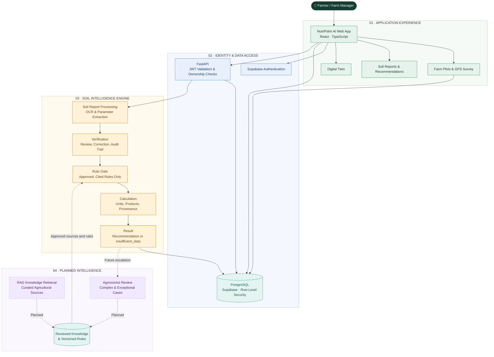
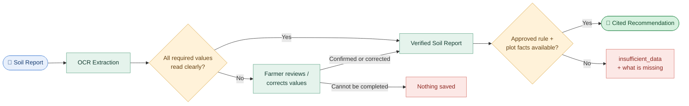
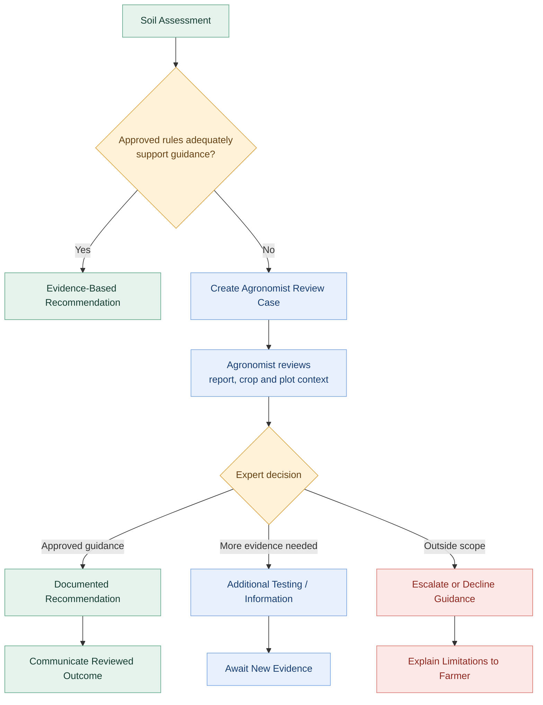

# 🌴 NutriPalm AI

<div align="center">

### INTELLIGENCE BENEATH THE SURFACE.

**Turning soil data into informed agricultural decisions.**

An agricultural intelligence platform by **Samruddhi Organics**

Soil-report intelligence, evidence-gated fertilizer recommendations, and farm-level digital twins — with a roadmap toward retrieval-grounded AI and professional agronomic review.

[](https://react.dev/)
[](https://fastapi.tiangolo.com/)
[](https://supabase.com/)
[](https://www.python.org/)
[](#-contributors-and-license)

</div>

---

## 📑 Contents

[Vision](#-the-vision) · [Product](#-the-product) · [Honest status](#-honest-status) · [Architecture](#-system-architecture) · [How a recommendation is made](#-how-a-recommendation-is-made) · [Digital Twin](#-the-digital-twin) · [Planned: RAG](#-planned-rag-powered-agricultural-intelligence) · [Planned: agronomist review](#-planned-the-agronomist-review-network) · [Security](#-security-model) · [Tech](#-technology-foundation) · [Roadmap](#-development-roadmap) · [Getting started](#-getting-started)

---

## 🌱 The vision

Agricultural decisions depend on understanding the soil, the crop, and the conditions in which they grow. Yet soil reports are hard to interpret, farm information is fragmented, and exceptional cases need expertise that a generic automated system cannot replace.

**NutriPalm AI brings these pieces together.** It turns soil-test reports into structured, verified data, checks whether that data and an applicable, approved rule support a recommendation, and gives every farm plot a digital identity.

Its long-term direction is a source-grounded agricultural assistant and a professional agronomist review network — built on a rule base that is traceable to published sources, never on invented numbers.

## ✨ The product

<table>
<tr>
<td width="50%" valign="top">

### 🌿 Soil Intelligence

**From laboratory report to meaningful insight.**

- OCR extraction (text layer, or Tesseract for scans and photos) — local, no cloud OCR
- Per-value validation: range, unit, confidence, provenance
- Review and correction step; the original reading is kept in an audit trail
- A verified soil report is created only from values that were read clearly or confirmed by the farmer
- Evidence-gated fertilizer recommendations with rule citation, calculation inputs and engine version
- Historical soil tests and advice per plot

</td>
<td width="50%" valign="top">

### 🗺️ Farm Digital Twins

**Every plot. A digital identity.**

- GPS boundary survey, area and centroid
- Farmer-to-plot association and plot records (planting date, palm count, state, irrigation)
- Live weather, satellite NDVI when configured, and modelled indicators clearly labelled as estimates
- Verified soil tests, **advice**, and **fertilizer actually applied** shown as three separate lists
- English and Kannada interface

</td>
</tr>
</table>

### Built around responsible recommendations

NutriPalm AI does not treat a soil report as a plain calculator input. It asks whether the data **and** an approved, applicable rule support a recommendation. When the evidence is missing, it answers `insufficient_data`, names exactly what is missing, and saves nothing — it never invents a fertilizer quantity.

A recommendation is **advice**, never a record that something happened.

**Removed from the product** (UI, routes, API, tests): Disease Intelligence, Crop Suitability, the standalone Weather advisory page, the Analytics dashboard. The repository contains no RAG/chat module yet. Database migrations and stored rows (including `disease_assessments`) are untouched.

---

## 🔎 Honest status

| Area | State |
|---|---|
| Soil-report OCR → review → verified report | **Works** and is tested (real Tesseract/Poppler, in a container too). **Accuracy is not established**: the only real document is one soil-health card (anecdote, not a figure); the harness prints `INSUFFICIENT SAMPLE` below 30 documents per report type |
| Fertilizer engine | **Complete and tested**, two rule kinds (below). **No rule is approved**, so every request returns `insufficient_data` |
| Digital Twin | Works on real plot data; synthetic and invented values are filtered out or shown as "Not available" |
| Managed Supabase / hosted deployment | **Not verified.** Local, PGlite and emulator results only |
| Sentinel Hub NDVI | Code wired; the configured OAuth client is rejected (HTTP 401), so NDVI shows as unavailable |
| RAG assistant, agronomist review network | **Planned**, not built |

### Crop-by-crop

| Crop | Source-backed candidate rule | Engine | Active rule |
|---|---|---|---|
| Oil palm | ICAR *Indian Farming* 2019, Table 1 (g N / P₂O₅ / K₂O per palm per year, by palm age) | ready | **no — awaiting agronomist** |
| Coconut | ICAR-CPCRI authors, *Indian Horticulture* 2022, Table 1 | ready | **no — awaiting agronomist** |
| Arecanut | Same 2022 article, Table 2 (+ a CPCRI KVK leaflet) | not an engine crop yet | no |
| Rice, maize, sugarcane, banana | none found | no sourced model | no |

Candidate records live in [`backend/app/services/data/candidate_rules/`](backend/app/services/data/candidate_rules/). They are **never loaded**; the shipped rule pack [`verified_rules.json`](backend/app/services/data/verified_rules.json) is empty, and a test pins that. Sources, schedules, and crop targets require formal agronomist review before approval.

### Known limitations

* Nothing implies endorsement by, or data from, ICAR or any cited institution. Reuse permission for the cited tables is not established.
* Published schedules are applied as printed. **Soil-test values are stored with the advice but do not change the dose**, because no sourced adjustment rule is installed.
* Crop variety, organic manure already applied, losses, and leaf analysis are not modelled. IoT soil-moisture sensors are not connected.
* Product grades for urea, DAP, MOP and SSP were read from a consolidated copy of the Fertiliser (Control) Order 1985 and must be re-confirmed against the current Schedule I.
* Kannada strings added recently are a first draft awaiting native-speaker review.

---

## 🏗️ System architecture

The farmer-facing app, authenticated data access, soil intelligence services, and plot records are separate layers. Planned AI and expert-review capabilities attach to this foundation without replacing the rule engine.



<div align="center">

**Green** — Application · **Blue** — Identity and data access · **Gold** — Soil intelligence · **Purple dashed** — Planned

</div>

### How a soil assessment works



### Processing states

| `status` | Meaning |
|---|---|
| `failed` | Nothing could be read. **Nothing is saved.** |
| `needs_review` | Values were read but a person must confirm or correct some. No soil report exists yet. |
| `completed` | A verified soil report exists (`auto_validated`, `user_confirmed` or `user_corrected`). |

Re-uploading the same document for the same plot reuses the stored extraction (idempotent by owner, plot and SHA-256). Documents themselves are never stored.

---

## 🧮 How a recommendation is made

The engine has two rule kinds. Both must be backed by an **approved, cited record** before any number reaches a farmer.

**1. Published schedule** (the kind the verified sources support): doses per palm per year by palm age, used exactly as printed.

```text
age_year        = whole years since the plot's planting date + 1
per palm        = the schedule band for that age   (g N, g P₂O₅ or P, g K₂O or K per palm per year)
plot total (kg) = per palm (g) × recorded palm count ÷ 1000
per hectare     = plot total ÷ plot area in hectares
products        = DAP for phosphorus (its nitrogen is credited once) → urea for remaining N → MOP for potassium
```

**2. Sufficiency target** (the original deficit model, still gated and currently without sourced targets): `target − verified soil value = nutrient to add`.

**Units are explicit.** Fertilizer labels state P as P₂O₅ and K as K₂O; elemental P = 0.4364 × P₂O₅ and K = 0.8302 × K₂O (from standard atomic weights). Every conversion carries a declared basis (`elemental` or `oxide`); a rule's stated basis must match the engine's or it cannot be activated. An earlier version under-dosed elemental P by 2.29× and K by 1.20×; that is fixed and tested.

**The engine refuses, with named reasons, when** the plot lacks a planting date, palm count or (for region-bound rules) a state; the planting date is in the future; the palms are older than a closed schedule covers; the crop is unsupported; or no approved rule exists. A refusal saves nothing.

**A rule is activated only if** it is approved by a named reviewer with a role and a past date, cites a source (title, publisher, edition, year, locator, verbatim quote), states stage, region, units, basis and assumptions, passes plausibility and contiguity checks, records where the product grades were verified, and is the only record for its crop. Check a file without activating it:

```bash
cd backend && python -m app.services.rule_provenance check path/to/records.json
```

Every stored recommendation carries `engine_version`, `generated_at`, the soil values used, the rule citation, the calculation inputs, assumptions, and what was **not** considered. Yield, revenue and ROI are omitted unless the cited source supports them.

---

## 🗺️ The Digital Twin

| Shown | Origin | When unavailable |
|---|---|---|
| Plot, boundary, area, planting date, palm count, stage, irrigation | `plots` row owned by the user | "Not available" |
| Soil values and history | verified `soil_reports` only | "No verified soil test yet" |
| Recommendations | engine-stamped rows only, always labelled **advice** | empty state |
| Fertilizer applied | what the farmer recorded | "No application recorded yet" |
| Current weather | Open-Meteo at the plot centroid | "N/A" |
| Live scores (water stress, disease-risk model, crop-health fusion, oil-palm yield estimate) | documented formulas over live data — **modelled estimates, not measurements, not agronomically validated** | "N/A" |
| NDVI | non-synthetic readings; Sentinel Hub when credentials work | "Config required" |
| Soil moisture, cadastral parcel | not connected | "Not connected" / unavailable |

---

## 🧠 Planned: RAG-powered agricultural intelligence

<sub>PLANNED FEATURE · NOT YET IMPLEMENTED</sub>

The next stage is Retrieval-Augmented Generation: retrieve relevant agricultural references before generating an explanation or answering a farmer's question.

`Agricultural Documents → Text Processing → Embeddings & Retrieval → Relevant Evidence → Grounded AI Response`

The planned assistant will support source-grounded answers that identify their supporting material, plain-language soil-report explanations, interpretation of why a rule applies and what limitations remain, context-aware questions using soil, crop and plot data, and controlled, versioned knowledge updates.

Published agricultural research and verified university fertilizer schedules serve as the starting corpus, recording publisher, date, locator, and verification basis.

**RAG will complement the rule engine. It will not independently establish dosages, manufacture evidence, or override approved rules.**

---

## 🧑‍🌾 Planned: the agronomist review network

<sub>PLANNED WORKFLOW · HUMAN-IN-THE-LOOP DECISION SUPPORT · NOT YET IMPLEMENTED</sub>

**AI can identify patterns. Agricultural professionals must assess the cases that fall outside them.**

Conflicting soil indicators, questionable laboratory values, unsupported crops, region-specific requirements, or cases where a wrong treatment could harm a crop should be routed to a qualified agronomist instead of forcing an answer.



**What the agronomist should receive:** the original report and extracted values, verification status and OCR uncertainties, crop/stage/plot details, the engine's result and why it escalated, the relevant rules and references, and prior assessments — with *measured facts, estimates, missing information and expert conclusions* kept distinct.

**What the professional can do:** approve or modify a supported recommendation, request another test or more information, recommend investigation, or decline to advise. An approved review retains reviewer identity and role, rationale, sources, timestamp, details and precautions.

**Building the knowledge base:** reviews may improve the reusable rule base only through controlled approval. An individual recommendation never becomes a universal rule automatically: a structured review procedure and record template ensure a record carries no approval until a named reviewer signs it.

---

## 🔐 Security model

Supabase Auth issues the session. The FastAPI backend verifies the JWT (PyJWT; `exp`, `aud`, `sub` required; algorithm pinned; key type must match; every failure is a 401) and then checks plot, report and extraction ownership in code, because it holds the service-role key, which bypasses row-level security. Another user's id answers `404`, identical to a missing one.

The browser holds only the public anon key, so row-level security protects the direct path, and migration 013 stops the browser from writing anything that claims to be verified or engine-generated. Uploads are size, type and magic-byte checked, processed in memory, never written to disk, and bounded by page, time, pixel and concurrency limits. Startup fails in staging/production if required settings are missing; CORS has no wildcard outside development; secrets never reach the bundle (scanned). Missing data is shown as missing.

---

## 🧰 Technology foundation

| Layer | Technology |
|---|---|
| User experience | React 19, TypeScript, Vite, Tailwind |
| Application API | Python, FastAPI |
| Authentication | Supabase Auth |
| Data persistence and authorization | PostgreSQL, Supabase, Row-Level Security (migrations `001`–`013`) |
| Soil document processing | pdfplumber, Tesseract, Poppler (local) |
| Fertilizer decision support | Evidence-gated rule engine (`rule_provenance.py`, `schedule_engine.py`, `fertilizer_catalog.py`) |
| Geospatial | GPS boundary records, Open-Meteo, Sentinel Hub (optional) |
| Packaging | Docker image for the backend (non-root, read-only-capable) |
| Planned intelligence | RAG retrieval and agronomist-assisted review |

---

## 🚀 Development roadmap

<div align="center">

| NOW | NEXT | LONG-TERM |
|:---:|:---:|:---:|
| **Soil Intelligence** | **Approved rule base** | **Expert Network** |
| OCR, review, verified reports, evidence-gated engine | Agronomist approval of oil palm and coconut; more crops with real sources | Structured professional reviews and approved knowledge updates |
| **Farm Digital Twins** | **RAG Assistant** | **Continuous Validation** |
| Plot identity, live data, advice vs applied | Source-grounded agricultural Q&A | Evaluation against expert-reviewed cases |

</div>

The immediate priority is a dependable, source-backed rule base and a clear escalation process. RAG and professional review extend the system without compromising the integrity of its recommendations.

---

## 💻 Getting started

**Prerequisites:** Node.js 20+, Python 3.11+, a Supabase project (use a **disposable** one for testing), Tesseract OCR and Poppler for scanned documents.

```bash
git clone https://github.com/gee-46/NutriPalm-AI.git
cd NutriPalm-AI
npm install
cd backend && python -m venv .venv && . .venv/bin/activate      # Windows: .venv\Scripts\activate
pip install -r requirements-dev.txt                              # runtime + test deps; use requirements.txt in production
cp .env.example .env                                             # then fill in backend/.env
cd .. && cp .env.example .env.local                              # then fill in the frontend values
```

Apply every file in `supabase/migrations/` in numeric order (`001` … `013`; apply `013` before deploying the backend), then start both services:

```bash
cd backend && python -m uvicorn app.main:app --reload --port 8000     # docs /docs · liveness /health · readiness /health/ready
npm run dev                                                           # http://localhost:5173
```

Never commit `backend/.env`. Frontend `VITE_*` values are public by design. Configuration reference: [`.env.example`](.env.example) and [`backend/.env.example`](backend/.env.example). Details: [`SETUP.md`](SETUP.md).

**Backend container:**

```bash
docker build -t nutripalm-backend backend/
docker run --rm -p 8000:8000 --env-file backend/.env nutripalm-backend
curl http://localhost:8000/health/ready      # 200 only if config, Tesseract and Poppler are present
```

### Use your own approved rules

Point a deployment at its own pack with `RULE_PACK_PATH`. Start from a candidate record, resolve its open questions with an agronomist, add the reviewer and date, and validate with the `check` command above. Do not edit a record to "pass" validation without the underlying approval.


## 🤝 Contributors and license

<div align="center">

### 🌴 NutriPalm AI

*Better soil understanding. Smarter farm decisions. A more connected agricultural future.*

**Developed by Gautam N Chipkar & Team**
Samruddhi Organics

[Repository](https://github.com/gee-46/NutriPalm-AI)

</div>

No `LICENSE` file is present; the project's stated position is **All Rights Reserved**. Add a license before any redistribution.
